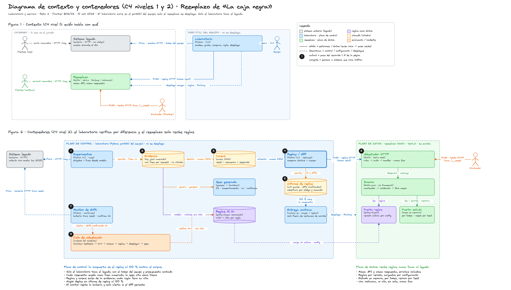

# Architecture



Source: [`architecture.excalidraw`](architecture.excalidraw).

## Problem shape

The original service is a black box: an HTTP ledger whose rules are only observable through requests. The replacement must answer byte-for-byte like the original, and the original's rules can change during the event. Two consequences drive the design:

1. **Behaviour must be evidence, not opinion.** Every rule the replacement implements cites the recorded request that proved it.
2. **Rules will change; code should not.** The replacement treats business rules as data so a rule change is a new policy file, not a redeploy with new logic.

## Two planes

| Plane | Where it runs | Role |
|---|---|---|
| **Data plane** (`replica/`) | Railway, single instance | Serves the evaluator's traffic. Kotlin + Vert.x, hexagonal. Never calls the original. |
| **Control plane** (`control-plane/harness/`) | Operator's machine | Records, replays, monitors and diffs the original; fits unknown algorithms; derives policies and the specification from the log. Never deployed. |

The planes share two artefacts only: the policy JSON (`rules/`) that the control plane derives and the data plane loads, and the recorded corpus (`control-plane/corpus/`) that gates every deploy.

## Data plane: hexagonal layout

```
replica/src/main/kotlin/cn/
  domain/            pure Kotlin, no framework imports
    Policy.kt        the rules-as-data model (limits, integrity, http contract, commands, responses, errors)
    MsgPipeline.kt   the single request pipeline: parse -> integrity -> command rules -> effect -> response
    Rules.kt         rule registry; each rule is a small function selected and parametrized by the policy
    Iso7064.kt / ControlAlgorithms.kt  control-digit algorithms (ISO 7064 MOD 97-10 and alternatives)
    Ledger.kt        in-memory state: accounts, operations, strike counters, id sequences
  adapters/
    http/HttpVerticle.kt     inbound port: routes, auth scheme, body limits, error envelopes, all from the policy
    config/PolicyLoader.kt   outbound port: loads and validates the policy at boot (file or POLICY_JSON)
    json/VertxJsonCodec.kt   serialization with the exact key order and literals the original uses
```

- The domain depends on nothing; adapters depend on the domain. Tests exercise the domain directly against the recorded log (`DomainFidelityTest`) and the whole stack over HTTP (`HttpFidelityTest`).
- The pipeline is total: every input maps to exactly one response, in the same precedence order the original exhibits (E103 > E104 > E201 > E202 > E301 > E302 > command-specific rules).
- Concurrency: one event loop owns the ledger, so sequences are serialised without locks; the HTTP layer streams bodies with a hard byte cap before parsing.

## Rules as data

`rules/policy-v1.json` holds every value that can change (limits, error order, control-digit format, routes, auth scheme, command arities, response literals). Each value carries an `evidencia` field pointing at log lines. Switching behaviour is `POLICY=v2` or injecting `POLICY_JSON`; the policy is validated at boot so a malformed rule fails fast instead of serving wrong answers.

## Control plane: how the evidence is produced

1. **Record** (`record.py`): sends curated cases to the original and stores request and response verbatim in `control-plane/experiments/log.jsonl`.
2. **Replay** (`replay.py`): runs the corpus against any target and reports step-level diffs; 100 % is the deploy gate.
3. **Monitor** (`monitor.py`): periodic battery against the original with throttling, request budget, re-confirmation on mismatch, and infrastructure-noise classification. A real drift produces a localized diff, not an alarm.
4. **Probe catalogue** (`probes.py`, `sondas.json`): discriminating requests per change class (rules, contract, format, commands, state), each with the policy slot it would alter.
5. **Fit and templates** (`fit.py`, `templates.py`): brute-force search over control-digit algorithms and extraction of response templates, so a changed algorithm or wording is recovered from data instead of guessed.
6. **Spec generation** (`export_log.py`, `genspec.py`): the specification and the official experiment log are generated from the same log and cross-checked by content, so no claim exists without a request behind it.

## Principles borrowed from Designing Data-Intensive Applications

- **Immutable log as source of truth.** `control-plane/experiments/log.jsonl` is append-only; policy, corpus, spec and tests are derived views that can always be regenerated.
- **Derived data, rebuilt not patched.** When the original changes, the policy is re-derived and the spec regenerated; nothing is edited by hand.
- **Deterministic replay.** The same corpus against the same policy always gives the same answers, which makes diffs meaningful.
- **Explicit failure modes.** Budgets, throttles, timeouts, infra-vs-logic classification and a single-instance deployment are stated, not assumed.
- **Evolvability.** The contract (routes, auth, formats) lives in the policy, so schema-level drift is a data change too.

## Deployment

Single Railway instance, Dockerfile build, health check on an unguessable path, zero-overlap deploys. One instance is a deliberate choice: the evaluator resets state between tests and expects one consistent ledger; horizontal scaling would require shared state and buy nothing at 10 requests per second.

## What the day taught us

Four hidden rules surfaced after the first evaluation run, none of them guessable from a reasonable corpus: a confirmation value for `HALT` that halts the service until the next reset, an exemption from the transfer limit between accounts of the same holder, a successful deposit that unblocks a blocked account, and ASCII-only case folding of command names. Each one became a policy entry with cited evidence, a small rule function, a regenerated spec entry and a permanent regression case. Two honest refinements to the design:

- **Values are data; mechanisms are code.** The policy decides which rules apply and with which values. A genuinely new mechanism (a halted state, an exemption) still needs a few lines in the rule registry. The architecture makes that cheap, not free.
- **Discover by states, not only by values.** Curated and random cases found limits and texts; they missed state transitions. A systematic walk, every command from every known state, is the right first exploration. Equally, the evaluator talks to one shared ledger, so no other client may touch the replacement during a run; that isolation is now an explicit operating rule.
